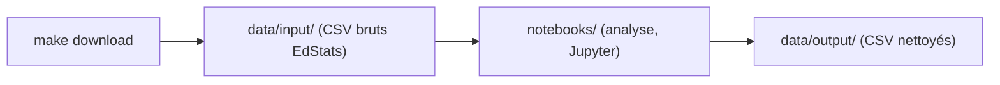

# Architecture

## Stack

- Python géré par `uv` (`pyproject.toml`, `uv.lock`), JupyterLab pour les notebooks
- pandas, numpy, matplotlib, seaborn, pycountry, requests

## How it fits together

## Key decisions

- Les CSV EdStats ne sont pas versionnés (trop volumineux) : `data/.gitignore` ignore les `*.csv` récursivement
- `data/input/` est en lecture seule, jamais modifié ; `data/output/` est produit par la phase d'analyse
- Les notebooks sont réservés aux données : aucun workflow (tasks, commits, statuts) n'y figure
- Un seul serveur Jupyter, sur le port 8888 (`make jupyter`) ; ne pas en lancer d'autres

## Gotchas

- Les autres ports visibles en local sont des kernels ipykernel des notebooks ouverts dans ce JupyterLab, pas des serveurs à réutiliser
