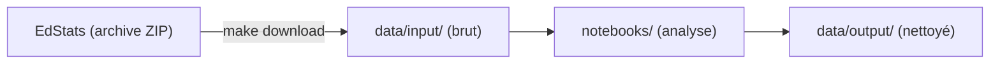

# Data

## Sources

- EdStats (Banque mondiale) : archive ZIP téléchargée par `make download` (URL câblée dans le `Makefile`), extraite dans `data/input/` (5 CSV)

## Pipeline

## Reproducibility

- Les CSV ne sont pas versionnés (`data/.gitignore`) : `make download` les récupère à l'identique
- `data/input/` jamais modifié ; chaque section de notebook recharge son CSV brut via `load_csv_analysis()` pour calculer

## Conventions des notebooks

- Aucune pré-analyse de la part de l'IA : ne jamais signaler à l'avance ce que contiennent les CSV ; l'utilisateur découvre en exécutant le nettoyage
- Affichage et calcul séparés : un DataFrame chargé pour l'aperçu ne calcule jamais dessus (pas de drop_duplicates, fillna, astype, statistiques)
- Chaque chiffre écrit en markdown est prouvé par une cellule qui calcule et affiche le résultat
- Code Python en anglais (variables, fonctions, commentaires, print), markdown en français ; les notebooks `data_overview` et `data_quality` gardent leur code en français (validé avant cette règle)
- Style simple : boucles `for`, listes, dicts ; éviter `apply`/`lambda` quand une boucle suffit
- Chaque terme anglais cité en markdown est suivi de sa traduction entre parenthèses
- Concis, vocabulaire simple, orienté débutant ; pas de consignes du projet répétées dans la doc ; ton du jeu de rôle, pas scolaire
- Pas de réponses toutes faites : poser les questions ouvertes, fournir les codes d'exploration, laisser l'utilisateur conclure
- L'IA peut écrire le code s'il reste simple et explicable étape par étape ; les décisions métier (catégories d'indicateurs, années, sélection finale, statistique d'agrégation) restent à l'utilisateur
- Les notebooks ne contiennent aucun workflow : tasks, commits et statuts vivent uniquement dans GitHub
